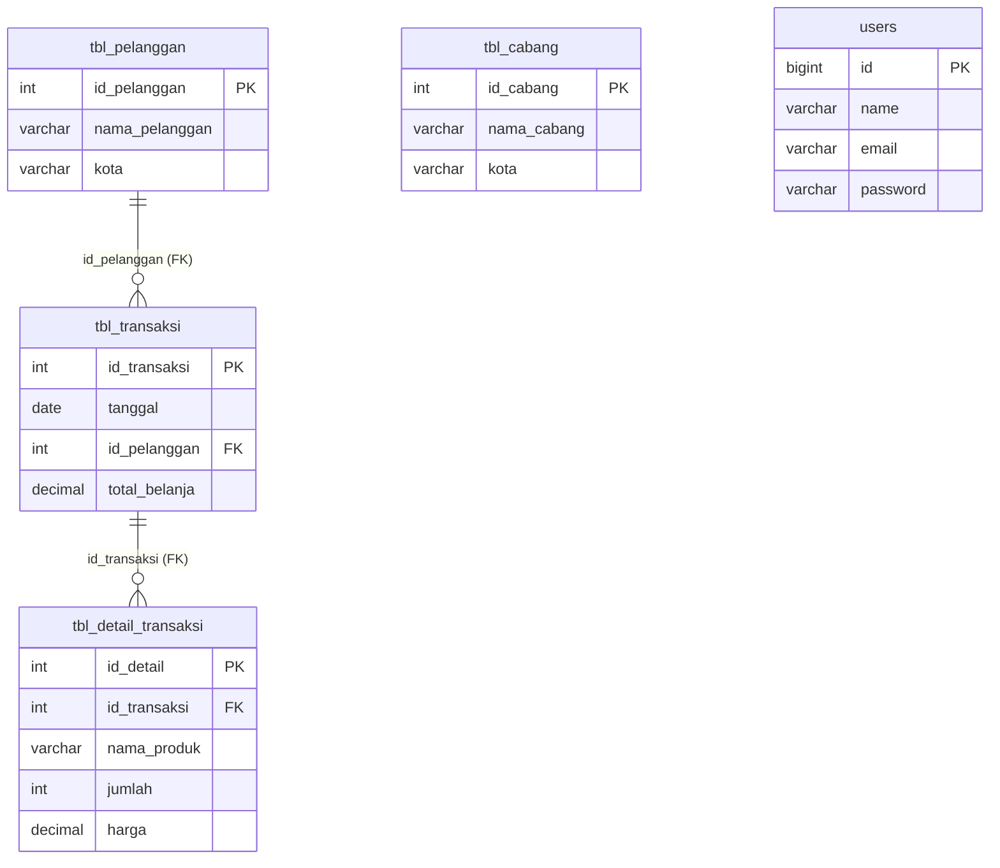

# DATABASE ANALYSIS — `db-toko`

Dokumen ini menganalisis seluruh struktur skema, data aktual, stored routine, trigger, view, serta anomali pada database `db-toko` (diverifikasi langsung dari `db-toko.sql` dan server lokal `10.4.32-MariaDB`).

---

## 1. Ringkasan Objek Database Aktual

Database `db-toko` menggunakan engine **InnoDB** dan berisi total **13 tabel** serta **4 views**, **6 stored procedures**, **5 stored functions**, dan **2 triggers**:

- **Tabel Bawaan Laravel (9 tabel):**
  `users`, `password_reset_tokens`, `sessions`, `cache`, `cache_locks`, `jobs`, `job_batches`, `failed_jobs`, `migrations` (3 baris tercatat pada batch 1).
- **Tabel Domain Toko (4 tabel):**
  `tbl_cabang` (4 baris), `tbl_pelanggan` (15 baris), `tbl_transaksi` (24 baris), `tbl_detail_transaksi` (10 baris).
- **Tabel yang Dirujuk Trigger/README Namun Tidak Ada:**
  `tbl_log`, `tbl_kategori`, `tbl_produk`.

---

## 2. Analisis Tabel, Kolom, Key, dan Tipe Data

### 2.1 Tabel `users` (Laravel Default)
| Kolom | Tipe | Null | Key | Default | Keterangan |
|---|---|---|---|---|---|
| `id` | `bigint(20) unsigned` | NO | PRI (AI) | - | Primary key |
| `name` | `varchar(255)` | NO | - | - | Nama user |
| `email` | `varchar(255)` | NO | UNI | - | Email login |
| `email_verified_at` | `timestamp` | YES | - | `NULL` | Waktu verifikasi email |
| `password` | `varchar(255)` | NO | - | - | Hash password |
| `remember_token` | `varchar(100)` | YES | - | `NULL` | Token remember me |
| `created_at` | `timestamp` | YES | - | `NULL` | Timestamp Laravel |
| `updated_at` | `timestamp` | YES | - | `NULL` | Timestamp Laravel |

- **Charset/Collation**: `utf8mb4` / `utf8mb4_unicode_ci`.
- **Jumlah Baris**: `0` (belum ada akun Admin maupun Kasir).
- **Kesenjangan**: Belum ada kolom `role` (`admin` / `kasir`), `is_active`, atau `id_cabang`.

### 2.2 Tabel `tbl_cabang`
| Kolom | Tipe | Null | Key | Default | Keterangan |
|---|---|---|---|---|---|
| `id_cabang` | `int(11)` | NO | PRI (AI) | - | Next AI: `5` |
| `nama_cabang` | `varchar(100)` | YES | - | `NULL` | Nama cabang |
| `kota` | `varchar(50)` | YES | - | `NULL` | Kota cabang |

- **Charset/Collation**: `utf8mb4` / `utf8mb4_general_ci`.
- **Timestamps**: Tidak ada (`created_at`/`updated_at` tidak tersedia).
- **Relasi/FK**: Tidak ada. Belum terhubung dengan `tbl_transaksi`, `tbl_pelanggan`, atau `users`.
- **Data Saat Ini (4 baris)**: Cabang Utama (Ponorogo), Cabang Madiun (Madiun), Cabang Jakarta (Jakarta), Cabang Surabaya (Surabaya).

### 2.3 Tabel `tbl_pelanggan`
| Kolom | Tipe | Null | Key | Default | Keterangan |
|---|---|---|---|---|---|
| `id_pelanggan` | `int(11)` | NO | PRI (AI) | - | Next AI: `16` |
| `nama_pelanggan` | `varchar(100)` | YES | - | `NULL` | Nama pelanggan |
| `kota` | `varchar(50)` | YES | - | `NULL` | Kota domisili |

- **Charset/Collation**: `utf8mb4` / `utf8mb4_general_ci`.
- **Timestamps**: Tidak ada.
- **Trigger Terkait**: `trg_insert_pelanggan` (AFTER INSERT), `trg_update_pelanggan` (AFTER UPDATE).
- **Anomali Data (15 baris)**:
  - Terdapat **duplikasi data pelanggan yang identik**:
    - `Andi` — `Ponorogo` (ID `1` dan ID `4`)
    - `Budi` — `Madiun` (ID `2` dan ID `5`)
    - `Citra` — `Surabaya` (ID `3` dan ID `6`)
  - Tidak ada kolom identitas pembeda (seperti `no_hp` / `telepon`, `email`, atau `alamat`) dan tidak ada `UNIQUE` constraint.

### 2.4 Tabel `tbl_transaksi`
| Kolom | Tipe | Null | Key | Default | Keterangan |
|---|---|---|---|---|---|
| `id_transaksi` | `int(11)` | NO | PRI (AI) | - | Next AI: `25` |
| `tanggal` | `date` | YES | - | `NULL` | Tanggal transaksi (tanpa jam) |
| `id_pelanggan` | `int(11)` | YES | MUL | `NULL` | FK ke `tbl_pelanggan.id_pelanggan` |
| `total_belanja` | `decimal(12,2)` | YES | - | `NULL` | Nilai total transaksi |

- **Charset/Collation**: `utf8mb4` / `utf8mb4_general_ci`.
- **Timestamps**: Tidak ada.
- **Foreign Key**: `tbl_transaksi_ibfk_1` (`id_pelanggan` -> `tbl_pelanggan.id_pelanggan`, `ON DELETE RESTRICT ON UPDATE RESTRICT`).
- **Kesenjangan**: Tidak ada kolom `id_cabang`, `user_id` (pencatat kasir), `kode_transaksi`/`invoice`, `status`, maupun `created_at`/`updated_at`.

### 2.5 Tabel `tbl_detail_transaksi`
| Kolom | Tipe | Null | Key | Default | Keterangan |
|---|---|---|---|---|---|
| `id_detail` | `int(11)` | NO | PRI (AI) | - | Next AI: `11` |
| `id_transaksi` | `int(11)` | YES | MUL | `NULL` | FK ke `tbl_transaksi.id_transaksi` |
| `nama_produk` | `varchar(100)` | YES | - | `NULL` | Nama produk disimpan sebagai teks statis |
| `jumlah` | `int(11)` | YES | - | `NULL` | Kuantitas item |
| `harga` | `decimal(12,2)` | YES | - | `NULL` | Harga satuan saat transaksi |

- **Charset/Collation**: `utf8mb4` / `utf8mb4_general_ci`.
- **Timestamps**: Tidak ada.
- **Foreign Key**: `tbl_detail_transaksi_ibfk_1` (`id_transaksi` -> `tbl_transaksi.id_transaksi`, `ON DELETE RESTRICT ON UPDATE RESTRICT`).
- **Kesenjangan**: Tidak ada `id_produk` karena tabel master produk belum ada. Produk hanya tersimpan sebagai string `nama_produk` (`Beras 5 Kg`, `Minyak Goreng`, `Gula Pasir`, `Telur 1 Kg`, `Mie Instan`).

---

## 3. Diagram Relasi Skema Saat Ini

> **Catatan:** `tbl_cabang` dan `users` belum memiliki relasi foreign key ke entitas lain pada skema awal.

---

## 4. Audit Data Integritas Awal (Anomali Penting)

Pemeriksaan langsung terhadap isi tabel `tbl_transaksi` dan `tbl_detail_transaksi` menemukan ketidakkonsistenan data historis:

1. **Selisih antara `total_belanja` header dan `SUM(jumlah * harga)` detail (Tx #1 – #6):**
   | `id_transaksi` | `total_belanja` (Header) | `SUM(jumlah * harga)` (Detail) | Jumlah Baris Detail | Selisih |
   |---:|---:|---:|---:|---:|
   | 1 | `250.000,00` | `175.000,00` | 2 | `+75.000,00` |
   | 2 | `350.000,00` | `101.000,00` | 2 | `+249.000,00` |
   | 3 | `150.000,00` | `92.500,00` | 2 | `+57.500,00` |
   | 4 | `500.000,00` | `130.000,00` | 2 | `+370.000,00` |
   | 5 | `250.000,00` | `84.000,00` | 1 | `+166.000,00` |
   | 6 | `350.000,00` | `150.000,00` | 1 | `+200.000,00` |
2. **Transaksi yatim tanpa detail item (Tx #7 – #24):**
   Sebanyak **18 dari 24 transaksi** (ID 7 hingga 24) memiliki header dan `total_belanja`, tetapi **0 baris** di `tbl_detail_transaksi`.
3. **Implikasi Pengembangan:**
   - Saat menampilkan detail transaksi lama (ID 1–24), UI **tidak boleh crash** jika detail kosong atau jika subtotal detail berbeda dengan `total_belanja` header.
   - Jangan mengubah atau menghapus 24 transaksi lama secara otomatis; untuk transaksi baru yang dibuat lewat aplikasi, backend wajib menghitung `total_belanja` secara akurat dari detail item dalam `DB::transaction`.

---

## 5. Audit Stored Procedures, Functions, Triggers, dan Views

### 5.1 Stored Procedures (6)
| Nama Procedure | Parameter | Logika & Catatan |
|---|---|---|
| `CariPelanggan` | `IN p_id INT` | `SELECT * FROM tbl_pelanggan WHERE id_pelanggan = p_id` |
| `CekTransaksi` | `IN p_id INT` | Mengembalikan string status `'Pelanggan Memiliki Transaksi'` / `'Belum Memiliki Transaksi'` |
| `HitungPelanggan` | `OUT jumlah INT` | Mengembalikan total baris `tbl_pelanggan` melalui `OUT` parameter |
| `LaporanTransaksi` | `IN p_id_pelanggan INT` | `INNER JOIN tbl_pelanggan` dan `tbl_transaksi` berdasarkan `id_pelanggan` |
| `TambahPelanggan` | `IN p_nama VARCHAR(100), IN p_kota VARCHAR(50)` | `INSERT INTO tbl_pelanggan (nama_pelanggan, kota)` (akan memicu `trg_insert_pelanggan`) |
| `TampilPelanggan` | *(tanpa parameter)* | `SELECT * FROM tbl_pelanggan` |

### 5.2 Stored Functions (5)
| Nama Function | Signature | Logika & Catatan |
|---|---|---|
| `HitungDiskon` | `(harga DECIMAL(12,2), diskon INT) -> DECIMAL(12,2)` | Mengembalikan nominal potongan `harga * (diskon / 100)` |
| `HitungPajak` | `(harga DECIMAL(12,2)) -> DECIMAL(12,2)` | Mengembalikan PPN 11% (`harga * 0.11`) |
| `HitungTotal` | `(harga DECIMAL(12,2), jumlah INT) -> DECIMAL(12,2)` | Mengembalikan `harga * jumlah` |
| `KategoriBelanja` | `(total DECIMAL(12,2)) -> VARCHAR(30)` | `>= 1.000.000` `'Pelanggan Gold'`, `>= 500.000` `'Pelanggan Silver'`, lainnya `'Pelanggan Reguler'` |
| `KonversiNilai` | `(nilai INT) -> VARCHAR(2)` | Konversi nilai huruf A–E (objek non-domain toko/latihan SQL, biarkan utuh namun tidak perlu dipakai aplikasi) |

### 5.3 Triggers (2) — **BLOCKER KRITIS**
| Nama Trigger | Tabel & Event | Definisi Aksi | Status |
|---|---|---|---|
| `trg_insert_pelanggan` | `tbl_pelanggan` (`AFTER INSERT`) | `INSERT INTO tbl_log (aktivitas, waktu) VALUES (CONCAT('Pelanggan baru ditambahkan: ', NEW.nama_pelanggan), NOW())` | **ERROR RUNTIME (`tbl_log` tidak ada)** |
| `trg_update_pelanggan` | `tbl_pelanggan` (`AFTER UPDATE`) | `INSERT INTO tbl_log (aktivitas, waktu) VALUES (CONCAT('Data pelanggan diubah ID: ', NEW.id_pelanggan, ' dari ', OLD.nama_pelanggan, ' menjadi ', NEW.nama_pelanggan), NOW())` | **ERROR RUNTIME (`tbl_log` tidak ada)** |

> **Dampak:** Setiap `INSERT` atau `UPDATE` ke `tbl_pelanggan` saat ini **pasti gagal** (`SQLSTATE[42S02]: Base table or view not found: 1146 Table 'db-toko.tbl_log' doesn't exist`).
> **Catatan keamanan trigger:** Pada `trg_update_pelanggan`, jika `OLD.nama_pelanggan` atau `NEW.nama_pelanggan` bernilai `NULL`, hasil `CONCAT(...)` menjadi `NULL` di MySQL/MariaDB. Oleh karena itu kolom `aktivitas` pada `tbl_log` harus nullable atau validasi aplikasi memastikan `nama_pelanggan` wajib diisi (`NOT NULL`/required).

### 5.4 Database Views (4)
| Nama View | Sumber Tabel | Kolom Output | Catatan Teknis |
|---|---|---|---|
| `view_laporan_transaksi` | `tbl_pelanggan` INNER JOIN `tbl_transaksi` | `id_pelanggan, nama_pelanggan, id_transaksi, tanggal, total_belanja` | Siap dibaca sebagai model read-only atau query laporan |
| `view_pelanggan` | `tbl_pelanggan` | `id_pelanggan, nama_pelanggan, kota` | Proyeksi sederhana `tbl_pelanggan` |
| `view_total_belanja` | `tbl_pelanggan` LEFT JOIN `tbl_transaksi` (GROUP BY) | `id_pelanggan, nama_pelanggan, total_transaksi, total_belanja` | Bagus untuk laporan agregat pelanggan + deteksi pelanggan dengan `0` transaksi |
| `view_transaksi_pelanggan` | `tbl_transaksi` INNER JOIN `tbl_pelanggan` | `id_transaksi, tanggal, nama_pelanggan, kota, total_belanja` | Siap untuk tabel riwayat transaksi beserta kota |

> **Peringatan Portabilitas (`DEFINER`):** Seluruh Procedures, Functions, Triggers, dan Views memiliki `DEFINER = 'root'@'localhost'` (`SQL SECURITY DEFINER`). Pada lingkungan lokal XAMPP/Laragon `root@localhost` aman, tetapi jika dideploy ke server produksi dengan user database berbeda, objek-objek ini bisa ditolak aksesnya atau perlu recreate definer.

---

## 6. Perbedaan Collation & Tipe Key (Peringatan Migration)

1. **Perbedaan Collation:**
   - Tabel bawaan Laravel (`users`, `sessions`, dll.) memakai `utf8mb4_unicode_ci`.
   - Tabel `tbl_*` dan views memakai `utf8mb4_general_ci`.
   - Saat membuat tabel baru yang berelasi atau melakukan perbandingan string (`=`, `LIKE`) lintas tabel, pastikan collation diselaraskan atau berhati-hati pada kolom string yang di-JOIN.
2. **Perbedaan Tipe Primary Key:**
   - Tabel `tbl_cabang`, `tbl_pelanggan`, `tbl_transaksi`, `tbl_detail_transaksi` memakai **`INT(11)` signed**, **bukan `BIGINT UNSIGNED`** (`$table->id()`).
   - Setiap migration yang menambahkan Foreign Key ke tabel `tbl_*` lama **wajib menggunakan `$table->integer(...)`** (bukan `$table->foreignId(...)` / `unsignedBigInteger`) agar MySQL/MariaDB tidak menolak pembuatan constraint (`errno: 150 Foreign key constraint is incorrectly formed`).
3. **Dampak ke Testing SQLite:**
   - Jika pengujian tetap memakai SQLite `:memory:`, objek spesifik MySQL/MariaDB (Stored Procedure, Function, Trigger `NOW()`, dan View di `db-toko.sql`) tidak tersedia otomatis kecuali testing diarahkan ke database test MySQL/MariaDB atau skema dimigrasi terstruktur melalui Laravel migrations.

---

## 7. Kebutuhan Migration Tambahan yang Direkomendasikan

Seluruh perubahan harus dibuat melalui **file migration baru** tanpa menghapus data maupun objek SQL lama:

| Urutan | Nama Migration yang Disarankan | Tujuan & Kolom Utama |
|---|---|---|
| 1 | `create_tbl_log_table` | Memperbaiki blocker trigger `tbl_pelanggan`. Kolom: `id_log` (`increments`/`id`), `aktivitas` (`text` / `varchar(255)` nullable), `waktu` (`dateTime` nullable / `useCurrent`). |
| 2 | `add_role_and_cabang_to_users_table` | Menambah `role` (`string(20)->default('kasir')->index()`), `id_cabang` (`integer('id_cabang')->nullable()` FK ke `tbl_cabang`), `is_active` (`boolean()->default(true)`). |
| 3 | `create_tbl_kategori_table` | Master kategori produk untuk storefront & admin: `id_kategori` (`increments`), `nama_kategori` (`varchar(100)`), `slug` (`varchar(120)->unique()`), `deskripsi` (`text->nullable()`), `gambar` (`varchar(255)->nullable()`), `is_active` (`boolean()->default(true)`), `timestamps()`. |
| 4 | `create_tbl_produk_table` | Master barang/produk: `id_produk` (`increments`), `id_kategori` (`unsignedInteger` FK -> `tbl_kategori`), `kode_produk` (`varchar(50)->unique()`), `nama_produk` (`varchar(150)`), `slug` (`varchar(180)->unique()`), `deskripsi` (`text->nullable()`), `harga` (`decimal(12,2)`), `stok` (`integer()->default(0)`), `gambar` (`varchar(255)->nullable()`), `is_featured` (`boolean()->default(false)`), `is_active` (`boolean()->default(true)`), `timestamps()`, `softDeletes()`. |
| 5 | `add_produk_id_to_tbl_detail_transaksi_table` | Menghubungkan detail transaksi ke master produk tanpa merusak 10 data historis: `id_produk` (`unsignedInteger->nullable()` FK -> `tbl_produk`, `nullOnDelete`), `subtotal` (`decimal(12,2)->nullable()`). |
| 6 | `add_metadata_to_tbl_transaksi_table` | Melengkapi audit & konteks operasional tanpa merusak 24 data historis: `kode_transaksi` (`varchar(50)->nullable()->unique()`), `id_cabang` (`integer('id_cabang')->nullable()` FK -> `tbl_cabang`), `user_id` (`foreignId('user_id')->nullable()->constrained('users')->nullOnDelete()`), `metode_pembayaran` (`varchar(30)->nullable()`), `status` (`varchar(20)->default('selesai')`), `catatan` (`text->nullable()`), `timestamps()`. |
| 7 | `add_contact_fields_to_tbl_pelanggan_table` *(Opsional)* | Jika disepakati aturan identifikasi unik pelanggan: `no_hp` (`varchar(20)->nullable()->unique()`), `alamat` (`text->nullable()`), `email` (`varchar(100)->nullable()`), `timestamps()`. |

