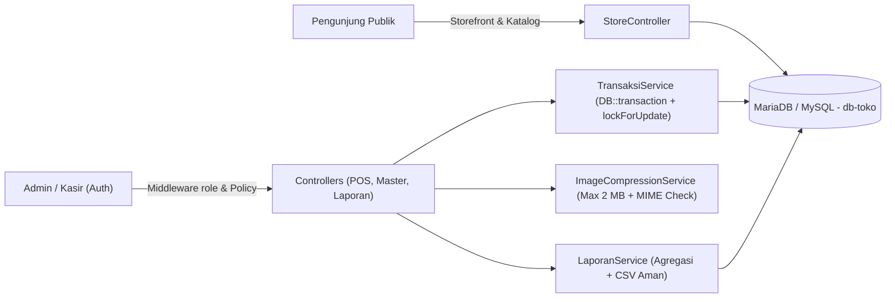

<div align="center">

# TokoKita — Aplikasi Toko, Storefront & Point of Sales (POS)

**Sistem manajemen retail modern berbasis web dengan storefront katalog minimalis, kasir POS real-time, cetak nota thermal (`40 mm`, `58 mm`, `80 mm`), auto file compression, serta otorisasi multi-role ketat.**

[](https://www.php.net/)
[](https://laravel.com/)
[](https://vuejs.org/)
[](https://inertiajs.com/)
[](https://tailwindcss.com/)
[](https://mariadb.org/)
[](#pengujian-dan-verifikasi)

[Fitur Utama](#fitur-utama) &bull;
[Arsitektur](#arsitektur-sistem) &bull;
[Hak Akses](#role-dan-hak-akses) &bull;
[Instalasi](#instalasi-dan-konfigurasi) &bull;
[Panduan POS](#panduan-transaksi-pos) &bull;
[Printer Thermal](#konfigurasi-printer-thermal) &bull;
[Pengujian](#pengujian-dan-verifikasi)

<br />


</div>

---

## Ringkasan Proyek

**TokoKita** menggabungkan etalase toko publik bergaya editorial yang bersih dengan panel operasional internal berkecepatan tinggi untuk **Administrator** dan **Kasir**. Aplikasi dibangun di atas fondasi skema `db-toko` dengan migration non-destruktif sehingga data historis, *view*, *stored routine*, dan *trigger* legacy tetap terjaga aman.

> [!IMPORTANT]
> Seluruh pembatasan hak akses **Admin vs Kasir** ditegakkan penuh di sisi server melalui Middleware (`EnsureUserHasRole`), Laravel Policy, Gate, Form Request, dan perhitungan transaksi otoritatif—bukan sekadar menyembunyikan tombol pada antarmuka Vue.

---

## Fitur Utama

### 1. Storefront Publik Minimalis (`/`, `/shop`, `/shop/{slug}`)
- **Beranda Editorial**: Hero promosi ([`public/images/store/hero-online-shopping.jpg`](public/images/store/hero-online-shopping.jpg)), daftar kategori unggulan (*Shop by Categories*), produk terlaris (*Our Bestsellers*), banner promo ([`public/images/store/promo-editorial.webp`](public/images/store/promo-editorial.webp)), serta navigasi desktop & mobile yang responsif.
- **Katalog & Detail Produk**: Pencarian real-time, filter kategori, pengurutan harga, status stok, dan rekomendasi produk terkait (hanya menampilkan item aktif).

### 2. Dashboard Khusus Per Role (`/dashboard`)
- **Dashboard Administrator**: Total produk, kategori, pelanggan, transaksi, total pendapatan riil, grafik tren harian/bulanan, produk terlaris, ringkasan stok kritis/menipis, dan 5 transaksi terbaru.
- **Dashboard Operasional Kasir**: Ringkasan transaksi hari ini, jumlah pelanggan dilayani, transaksi yang diproses kasir terkait, omzet harian sesuai izin `view-daily-sales`, serta pintasan cepat POS, tambah produk, dan tambah pelanggan.

### 3. Sistem Transaksi POS Aman (`/transaksi/create`)
- **Antarmuka Cepat Kasir**: Pencarian nama/SKU (mendukung `Enter` untuk SKU eksak), filter kategori, keranjang belanja dengan batas stok real-time, pemilihan metode bayar (`Tunai`, `QRIS`, `Transfer`, `Debit`), tombol cepat nominal tunai, serta kalkulasi kembalian / kurang bayar.
- **Integritas Finansial & Stok Backend**:
  - Diproses atomik dalam `DB::transaction` menggunakan penguncian baris `lockForUpdate()`.
  - Harga satuan, subtotal, total akhir, dan kembalian **dihitung ulang dari database di server** (`TransaksiService`); manipulasi harga/total dari browser diabaikan atau ditolak.
  - Menyimpan snapshot **nama kasir (`nama_kasir`)** serta **nama & harga produk** sehingga nota lama tetap konsisten walau harga produk berubah atau akun pengguna dihapus.

### 4. Cetak Nota Thermal Multi-Ukuran (`/transaksi/{id}/nota`)
- Mendukung pilihan lebar roll **40 mm (Mini)**, **58 mm (Standar)**, dan **80 mm (Lebar)** lewat `@page` dinamis dan `@media print`.
- Menyembunyikan seluruh sidebar, header, dan tombol toolbar saat dicetak sehingga kertas thermal tidak terbuang.
- Menampilkan **No Nota**, **Tanggal**, **Kasir** (dari snapshot transaksi atau operator aktif sebagai fallback transaksi historis), **Pelanggan**, rincian item dengan *word-wrapping* rapi, total akhir, pembayaran, dan kembalian.

### 5. Auto File Compression (Maksimal 2 MB)
- Terintegrasi pada form **Produk** dan **Kategori** melalui [`resources/js/Utils/imageCompression.js`](resources/js/Utils/imageCompression.js) dan [`app/Services/ImageCompressionService.php`](app/Services/ImageCompressionService.php).
- **Otomatis & Cerdas**:
  - File `<= 2 MB` disimpan langsung tanpa kompresi ulang dan mempertahankan format aslinya.
  - Gambar `> 2 MB` (`JPG`/`JPEG`, `PNG`, `WEBP`) dikompres otomatis secara bertahap (penyesuaian kualitas lalu penurunan resolusi proporsional menjaga aspek rasio & transparansi PNG) hingga `<= 2 MB`.
  - UI menampilkan ukuran *Before*, *After*, persentase penghematan (*Saved %*), status proses, dan pratinjau langsung, dilengkapi validasi ulang MIME & ekstensi di server via ekstensi `gd`/`exif`.

### 6. Manajemen Master Data, Laporan & Export CSV
- **Master Data**: Produk (dengan *soft delete* aman bagi riwayat transaksi), Kategori, Pelanggan (validasi anti-duplikasi nomor HP), Cabang, dan Pengguna + Pengaturan Role.
- **Laporan & Rekap (`/laporan`)**: Penjualan, rekap harian, metode pembayaran, performa cabang & kasir, produk terlaris, performa pelanggan, filter rentang tanggal/kasir/pelanggan/cabang, tampilan cetak laporan, serta **Export CSV** ber-BOM UTF-8 yang aman dari *formula injection*.

---

## Arsitektur Sistem



| Lapisan | Teknologi & Paket Utama |
| :--- | :--- |
| **Backend** | PHP `^8.2`, Laravel `^12.0`, Sanctum `^4.0`, Ziggy `^2.0` |
| **Frontend** | Vue `^3.4` (`<script setup>`), Inertia.js `^2.0`, Tailwind CSS `^3.2`, Vite `^7.0` |
| **Database** | MariaDB / MySQL (`db-toko` + tabel/view/trigger legacy dipertahankan) |
| **Kualitas & Uji** | PHPUnit `^11.5`, Laravel Pint `^1.24`, Vite Production Build |

<details>
<summary><strong>Lihat Struktur Direktori Utama Proyek</strong></summary>

```text
app-toko/
├── app/
│   ├── Http/
│   │   ├── Controllers/        # Store, Dashboard, Produk, Kategori, Pelanggan, Transaksi, Cabang, Laporan, User, Pengaturan
│   │   ├── Middleware/         # EnsureUserHasRole, HandleInertiaRequests
│   │   ├── Requests/           # Form Request validasi & otorisasi per modul
│   │   └── Resources/          # API/Inertia JSON Resources tanpa wrapping
│   ├── Models/                 # User, Produk, Kategori, Pelanggan, Cabang, Transaksi, DetailTransaksi, LogAktivitas
│   ├── Policies/               # Kebijakan otorisasi (403 enforcement per model)
│   └── Services/               # TransaksiService, LaporanService, ImageCompressionService
├── config/store.php            # Identitas toko untuk storefront & header nota
├── database/
│   ├── migrations/             # 15 file migration non-destruktif
│   └── seeders/                # UserSeeder, KategoriSeeder, ProdukSeeder (local/testing)
├── resources/js/
│   ├── Components/             # UI base, Forms, Tables, Feedback (ToastNotification, ConfirmDialog)
│   ├── Composables/            # usePermissions, useCurrency, useDate
│   ├── Layouts/                # StoreLayout, AdminLayout, CashierLayout
│   ├── Pages/                  # Store, Dashboard, Produk, Kategori, Pelanggan, Cabang, Transaksi, Laporan, Pengguna, Pengaturan
│   └── Utils/                  # imageCompression.js
├── routes/web.php              # Peta route publik, operasional (admin/kasir), dan admin-only
└── tests/Feature/              # Suite pengujian PHPUnit lengkap
```

</details>

---

## Role dan Hak Akses

| Modul / Fitur | Admin | Kasir | Penegakan Server |
| :--- | :---: | :---: | :--- |
| Storefront Publik (`/`, `/shop`) | Ya | Ya | Route publik |
| Dashboard Ringkasan Eksekutif & Grafik | Ya | Operasional | Role check + Gate `view-daily-sales` |
| Lihat & Tambah Produk Baru | Ya | Ya | `ProdukPolicy::viewAny` / `create` |
| Edit & Hapus Produk | **Ya** | **Tidak (`403`)** | Middleware `role:admin` & `ProdukPolicy` |
| Lihat & Tambah Pelanggan Baru | Ya | Ya | `PelangganPolicy::viewAny` / `create` |
| Edit & Hapus Pelanggan | **Ya** | **Tidak (`403`)** | Middleware `role:admin` & `PelangganPolicy` |
| Lihat, Riwayat & Buat Transaksi POS | Ya | Ya | `TransaksiPolicy` & Gate `view-transaction-history` |
| Cetak Nota Thermal (`40/58/80 mm`) | Ya | Ya | `TransaksiPolicy::view` |
| Kategori & Cabang (Lihat / Kelola) | Ya (CRUD) | Read-only (`403` mutasi) | Middleware `role:admin` |
| Laporan Penjualan & Export CSV | **Ya** | **Tidak (`403`)** | Middleware `role:admin` & Gate `view-reports` |
| Manajemen Pengguna & Pengaturan | **Ya** | **Tidak (`403`)** | Middleware `role:admin` & Gate `manage-settings` |

> [!NOTE]
> Registrasi publik (`/register`) dinonaktifkan. Penambahan akun staf serta perubahan role hanya dapat dilakukan oleh **Administrator**, dan sistem menolak upaya admin menurunkan/menonaktifkan akunnya sendiri.

---

## Instalasi dan Konfigurasi

### Prasyarat Sistem
- **PHP `>= 8.2`** (ekstensi `pdo_mysql`, `mbstring`, `openssl`, `fileinfo`, plus `gd` dan `exif` untuk Auto File Compression)
- **Composer**
- **Node.js `>= 20`** & **NPM**
- **MariaDB / MySQL** (misalnya via XAMPP atau Laragon)

### Setup Cepat (Rekomendasi)

> [!NOTE]
> Pastikan layanan MariaDB/MySQL aktif dan database `db-toko` sudah dibuat terlebih dahulu (`root` tanpa password sesuai `.env.example`), karena `composer run setup` langsung menjalankan `php artisan migrate --force`.

```bash
# 1. Masuk ke direktori proyek
cd app-toko

# 2. Instal dependensi, salin .env, generate APP_KEY, migrate, dan build aset
composer run setup

# 3. Buat symbolic link agar foto produk & kategori dapat diakses publik
php artisan storage:link
```

<details>
<summary><strong>Atau Instalasi Langkah demi Langkah &amp; Konfigurasi <code>.env</code></strong></summary>

1. Instal paket PHP dan Node.js:
   ```bash
   composer install
   npm install
   ```
2. Salin konfigurasi environment dan buat `APP_KEY`:
   ```bash
   cp .env.example .env
   php artisan key:generate
   ```
3. Sesuaikan koneksi database MariaDB/MySQL serta identitas toko pada `.env`:
   ```dotenv
   APP_NAME="TokoKita"
   APP_URL=http://127.0.0.1:8000
   APP_TIMEZONE=Asia/Jakarta

   DB_CONNECTION=mysql
   DB_HOST=127.0.0.1
   DB_PORT=3306
   DB_DATABASE=db-toko
   DB_USERNAME=root
   DB_PASSWORD=

   STORE_NAME="TokoKita"
   STORE_TAGLINE="Layanan Kasir & Kebutuhan Harian"
   STORE_ADDRESS="Jl. Melati No. 12, Ponorogo"
   STORE_PHONE="021-555-0199"
   STORE_HOURS="Buka Setiap Hari 08.00 - 21.00 WIB"
   STORE_LOGO_URL=
   ```
4. Buat database `db-toko` (atau impor `db-toko` awal jika tersedia), lalu jalankan seluruh migration:
   ```bash
   php artisan migrate
   php artisan storage:link
   ```

</details>

### Seeding Awal & Akun Uji (`local` / `testing`)

Untuk mengisi akun uji, kategori, dan produk contoh di environment lokal:

```bash
php artisan db:seed
```

| Role | Email | Password Default |
| :--- | :--- | :--- |
| **Admin** | `admin@toko.test` | `password` |
| **Kasir** | `kasir@toko.test` | `password` |

> [!TIP]
> Seeder bawaan (`UserSeeder`, `KategoriSeeder`, `ProdukSeeder`) otomatis melewati eksekusi bila `APP_ENV` bukan `local` atau `testing`. Segera ubah kata sandi sebelum deploy ke produksi.

### Menjalankan Aplikasi

```bash
# Mode Development (menjalankan Laravel server, queue listener, logs, & Vite HMR)
composer run dev

# Atau jalankan manual di 2 terminal terpisah:
php artisan serve
npm run dev
```

Untuk **Production Build**:

```bash
npm run build
php artisan config:cache
php artisan route:cache
php artisan view:cache
```

---

## Panduan Transaksi POS

1. Login sebagai **Admin** atau **Kasir**, lalu buka menu **Transaksi Baru** (`/transaksi/create`).
2. Pilih **Pelanggan** (atau gunakan pintasan **+ Pelanggan Baru** jika belum terdaftar) dan **Cabang**.
3. Cari barang lewat nama atau kode SKU (tekan `Enter` untuk SKU unik) lalu klik kartu produk agar masuk ke keranjang.
4. Sesuaikan **Jumlah Barang** dengan tombol `-` / `+` atau ketik langsung sesuai stok tersedia.
5. Pilih metode pembayaran (`Tunai`, `QRIS`, `Transfer`, atau `Debit`) dan masukkan **Uang Pembayaran** untuk melihat kembalian instan.
6. Klik **Proses Transaksi**. Server memvalidasi stok, menghitung ulang subtotal/total akhir, menyimpan snapshot produk & `nama_kasir`, lalu membuka halaman detail transaksi siap cetak.

---

## Konfigurasi Printer Thermal

Halaman `/transaksi/{id}/nota` menyediakan isolasi cetak khusus via `@media print`:

1. **Pilih Lebar Kertas pada Toolbar Nota**:
   - **58 mm (Standar)**: Pilihan utama untuk printer thermal kasir `58 mm` (`width: 58mm`, padding `3mm`).
   - **80 mm (Lebar)**: Untuk printer kasir meja `80 mm` (`width: 80mm`, padding `4mm`).
   - **40 mm (Mini)**: Direkomendasikan bila driver printer `58 mm` memiliki area cetak efektif `40–44 mm` agar angka sisi kanan tidak terpotong.
2. **Pengaturan Dialog Print Browser (Chrome / Edge)**:
   - **Destination**: Pilih printer thermal yang terpasang.
   - **Paper size**: Sesuaikan dengan roll kertas (`58mm Receipt` / `80mm Receipt`).
   - **Margins**: Pilih **None / Tidak Ada**.
   - **Scale**: Atur ke **100% / Default**.
   - **Options**: **Matikan** *Headers and footers* agar URL dan tanggal browser tidak ikut tercetak.

---

## Pengujian dan Verifikasi

Aplikasi menggunakan database terisolasi `db_toko_test` (lihat [`phpunit.xml`](phpunit.xml)) untuk mencegah gangguan terhadap database operasional `db-toko`.

```bash
# Menjalankan seluruh test suite PHPUnit (73 tests)
php artisan test

# Memeriksa standar format kode PHP (Laravel Pint)
vendor/bin/pint --test

# Memvalidasi kompilasi aset frontend (Vite + Vue 3 + Tailwind CSS)
npm run build
```

<details>
<summary><strong>Daftar Cakupan Suite Pengujian Otomatis</strong></summary>

- `tests/Feature/Auth/*` — Login, logout, validasi, rate limit, registrasi publik nonaktif, profil & password
- [`tests/Feature/RoleAuthenticationAndInertiaTest.php`](tests/Feature/RoleAuthenticationAndInertiaTest.php) — Proteksi guest, shared Inertia permissions, RBAC admin vs kasir
- [`tests/Feature/ProdukAuthorizationTest.php`](tests/Feature/ProdukAuthorizationTest.php) — Akses produk kasir (`create`/`view`) vs penolakan `403` untuk `edit`/`delete`
- [`tests/Feature/PelangganAuthorizationTest.php`](tests/Feature/PelangganAuthorizationTest.php) — Akses pelanggan & penolakan duplikasi nomor HP
- [`tests/Feature/AdminOnlyModulesAuthorizationTest.php`](tests/Feature/AdminOnlyModulesAuthorizationTest.php) — Proteksi modul khusus admin & blokir user nonaktif
- [`tests/Feature/TransaksiFlowTest.php`](tests/Feature/TransaksiFlowTest.php) — Checkout atomik, anti-tampering harga/total, snapshot `nama_kasir`, validasi stok, cetak nota `40/58/80 mm`
- [`tests/Feature/ImageAutoCompressionTest.php`](tests/Feature/ImageAutoCompressionTest.php) — Auto kompresi gambar `> 2 MB`, skip `<= 2 MB`, aspek rasio, validasi MIME/ekstensi
- [`tests/Feature/AdminDashboardAndReportsTest.php`](tests/Feature/AdminDashboardAndReportsTest.php) — Akurasi agregasi dashboard, grafik penjualan, filter laporan, & sanitasi formula CSV
- [`tests/Feature/StorefrontAndRelationsTest.php`](tests/Feature/StorefrontAndRelationsTest.php) — Storefront publik, filter katalog, & relasi antar model
- [`tests/Feature/Prompt11SecurityAndAuditTest.php`](tests/Feature/Prompt11SecurityAndAuditTest.php) — Security audit end-to-end, anti-spoofing transaksi, produk soft-delete pada struk, & halaman error Inertia (`403`/`404`)

</details>
